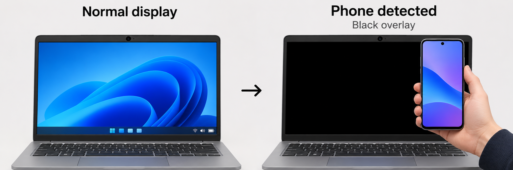

# Phone Screen Guard

A Windows desktop app that displays a black overlay when its webcam detects the selected trigger. Webcam frames are processed locally. The app starts at sign-in for the Windows account that installs it.

> **Preview build.** Keyboard and mouse blocking requires a live Windows test before broader rollout. Test input restoration and the emergency shortcut on your own laptop first.

## What the app does

Phone Screen Guard uses the webcam to detect a phone and, in selected modes, changes in the webcam feed. It displays a black overlay on the laptop display and connected monitors. It processes webcam frames on the computer. While the overlay is active, the app attempts to block ordinary keyboard and mouse input on the signed-in Windows desktop. It releases both when the overlay clears. The overlay does not lock the Windows session.

- **Mode 1** blanks the screen when the phone detector identifies a mobile phone in the webcam view.
- **Mode 2** also blanks when the webcam sends a dark or uniform image or stops providing frames.
- **Mode 3** adds a check for extremely blurred, low-detail images that can occur when a palm or object is held close to the lens.

## See it in action



Bring a phone into the webcam's field of view. Once detected, Phone Screen Guard covers the desktop with a black overlay. Move the phone out of view and the display returns after about two seconds of clear conditions.

## Choose an installer

| Package | Trigger |
| --- | --- |
| [PhoneScreenGuard-01-Phone-Only.zip](downloads/PhoneScreenGuard-01-Phone-Only.zip) | Phone detection |
| [PhoneScreenGuard-02-Phone-and-Shutter.zip](downloads/PhoneScreenGuard-02-Phone-and-Shutter.zip) | Phone detection and shutter-like camera feed changes |
| [PhoneScreenGuard-03-Phone-Shutter-and-Cover.zip](downloads/PhoneScreenGuard-03-Phone-Shutter-and-Cover.zip) | Phone detection, shutter-like changes, and low-detail lens covers |

## 1. Check Python on Windows

Requirements are Windows 10 or 11 (x64), a working webcam, and 64-bit Python 3.12. Internet access is needed for the initial dependency and model downloads.

Open a fresh **Command Prompt (CMD)** and run:

```cmd
python -c "import platform, struct, sys; print(sys.version.split()[0], struct.calcsize('P') * 8, platform.machine())"
```

Expected output looks like `3.12.10 64 AMD64`. If `python` is unavailable or selects a different version, try the Python Launcher:

```cmd
py -3.12 -c "import platform, struct, sys; print(sys.version.split()[0], struct.calcsize('P') * 8, platform.machine())"
```

If neither command finds Python 3.12 x64, install it and reopen CMD. If the Python installer offers **Add python.exe to PATH**, enable it. Either command working with the expected version is enough. [Python downloads for Windows](https://www.python.org/downloads/windows/)

## 2. Download and extract one installer

1. Click one ZIP in the table above and download it from GitHub.
2. In File Explorer, right-click the ZIP and select **Extract All**.
3. Open the extracted folder. It contains `Install.cmd`, `Uninstall.cmd`, `guard.pyw` and `START-HERE.txt`.

Install one mode per Windows account. To switch modes, exit the running app from the system tray first.

## 3. Run the installer

Double-click **Install.cmd** as the Windows user who will run the app. Administrator rights are unnecessary. To run the same setup from CMD, open the extracted folder in File Explorer, type `cmd` in the address bar and press Enter. Then run:

```cmd
Install.cmd
```

The installer sets up a Python virtual environment under `%USERPROFILE%\PhoneScreenGuard`, installs dependencies, downloads the YOLO model, and creates a startup entry for the current user. Keep the window open until **Setup complete** appears. A successful setup message confirms the install steps finished. The tray status confirms the app is running.

### What the installer runs

These are the commands behind `Install.cmd`. Use the installer for normal setup because it also copies the chosen mode, creates the sign-in entry and launches the app.

```cmd
python -m venv "%USERPROFILE%\PhoneScreenGuard\venv"
set "GUARD_PY=%USERPROFILE%\PhoneScreenGuard\venv\Scripts\python.exe"
"%GUARD_PY%" -m pip install torch torchvision --index-url https://download.pytorch.org/whl/cpu
"%GUARD_PY%" -m pip install "ultralytics==8.3.161" "PySide6==6.8.3"
pushd "%USERPROFILE%\PhoneScreenGuard"
"%GUARD_PY%" -c "import cv2; from PySide6 import QtWidgets; from ultralytics import YOLO; YOLO('yolo11n.pt')"
popd
```

If your installation uses the Python Launcher, the virtual-environment command is `py -3.12 -m venv "%USERPROFILE%\PhoneScreenGuard\venv"`. The model file `yolo11n.pt` is downloaded during setup.

## 4. Verify monitoring and automatic startup

1. Open the **^** system tray menu near the Windows clock and hover over the app icon. Confirm your mode number and **Monitoring**.
2. Hold a phone in view of the webcam. Test the shutter in Modes 2 and 3, and cover the entire lens with your palm in Mode 3.
3. Remove the phone or uncover the lens. The screen should return after about two seconds of clear conditions.
4. Sign out and sign in again to check that the app starts automatically. It works offline after the first successful setup.

### Verify keyboard and mouse blocking

1. Open Notepad and save any work in other apps.
2. Trigger the overlay using the phone or the camera trigger supported by your mode.
3. Try typing a few letters and moving or clicking the mouse.
4. Clear the trigger. Check that the desktop returns, the test letters were not inserted, and typing and mouse clicks work again.
5. Trigger the overlay again and press **Ctrl + Shift + F12** to pause monitoring. Once the overlay clears, use the same shortcut to resume.

If either Windows input hook fails to install, both inputs remain usable and the overlay can still appear. The tray tooltip reports **Input blocking unavailable** and `guard.log` records the error. If the desktop is stuck and the pause shortcut does not respond, use **Ctrl + Alt + Delete** to reach Windows' security screen. Sign out only if needed because it can close unsaved work.

### Expected behavior by mode

| Test | Mode 1 | Mode 2 | Mode 3 |
| --- | --- | --- | --- |
| A phone is detected | Black overlay | Black overlay | Black overlay |
| A closed shutter gives a dark, uniform or missing feed | No camera-triggered overlay | Black overlay | Black overlay |
| A close cover produces a blurred frame with little fine detail | No camera-triggered overlay | Depends on whether the feed is dark, uniform or missing | Black overlay if the frame meets the low-detail threshold |

Modes 2 and 3 trigger when the app detects a blocked frame or a camera read failure. If frames stop arriving without a read error, the app uses a 750 ms timeout. Actual response time depends on the camera and Windows.

### Start in the background

If you exited the app and want to launch it without keeping CMD open, run:

```cmd
start "" "%USERPROFILE%\PhoneScreenGuard\venv\Scripts\pythonw.exe" "%USERPROFILE%\PhoneScreenGuard\guard.pyw"
```

Automatic startup happens after the installing user signs in. To verify it, save your work, sign out, sign back in, and check the system tray. The app runs in that signed-in session.

## Troubleshooting

### Setup cannot find Python

Run the commands in step 1 in a new CMD window. If one finds Python 3.12 x64, run `Install.cmd` again from the extracted folder. An unavailable `py` launcher is fine when the `python` check passes.

### Setup fails while downloading packages or the model

Read the first error above **Setup failed**. Restore internet access if the error reports a download or connection failure, then run `Install.cmd` again. To verify the model file after setup:

```cmd
dir "%USERPROFILE%\PhoneScreenGuard\yolo11n.pt"
```

### The tray icon is missing

Open a normal CMD under the same Windows account and run:

```cmd
"%USERPROFILE%\PhoneScreenGuard\venv\Scripts\python.exe" "%USERPROFILE%\PhoneScreenGuard\guard.pyw"
```

If the app starts, keep this CMD window open during the test. To inspect the app log or open the current user's Startup folder, run:

```cmd
notepad "%USERPROFILE%\PhoneScreenGuard\guard.log"
explorer shell:startup
```

The Startup folder should contain `PhoneScreenGuard.cmd`. If camera access fails, check **Settings → Privacy & security → Camera → Let desktop apps access your camera** and close other apps using the webcam.

### The screen goes black in low light

Modes 2 and 3 use the webcam feed to infer shutter closure. A dark, uniform or unavailable feed can trigger either mode, including when an object covers the lens. Mode 3 also checks for extremely blurred, low-detail images. Partial covers and objects that leave visible detail may be missed.

### Switch to a different mode

1. Exit the running app from the tray.
2. Extract the ZIP for the new mode.
3. Run its `Install.cmd` under the same Windows account.
4. Hover over the tray icon and verify the new mode number.

## Update an existing installation

1. Exit Phone Screen Guard from the system tray.
2. Download and extract the updated ZIP for the desired mode.
3. If you previously edited `CAMERA_INDEX` in `%USERPROFILE%\PhoneScreenGuard\guard.pyw`, back up that file before setup and carry the setting forward.
4. Run the new `Install.cmd` under the same Windows account. Confirm the tray status and repeat the input and recovery tests.

## Uninstall

Exit Phone Screen Guard from the system tray. Open CMD in the extracted installer folder as described above and run:

```cmd
Uninstall.cmd
```

The script removes the app folder and startup entry for the current user.

Review the dependency and model terms for your intended use or redistribution. [Ultralytics licensing](https://www.ultralytics.com/license)


## Repository layout

| Path | Contents |
| --- | --- |
| `downloads/` | One Windows installer ZIP per mode |
| `src/mode-1/` | Phone-only source and install scripts |
| `src/mode-2/` | Phone and shutter source and install scripts |
| `src/mode-3/` | Phone, shutter and lens cover source and install scripts |
| `assets/` | README demo illustration |

Each installer contains the same files as its corresponding source folder. End users can download one installer ZIP. To inspect or run setup from source, clone or download the repository, open the desired `src/mode-N` folder, and run its `Install.cmd`.
